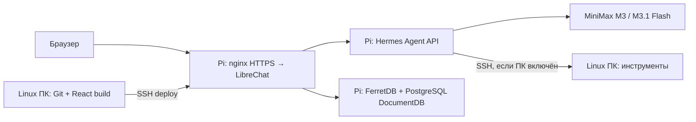

# Hermes: разработка на ПК, работа на Raspberry Pi

LibreChat, его база и Hermes API постоянно работают на Raspberry Pi. Pi принимает HTTPS,
авторизует пользователя и хранит историю. Выключение ПК не прерывает обычный чат.
Hermes использует ПК по SSH для терминальных задач, когда тот включён.

На Linux ПК находится Git checkout и выполняется сборка интерфейса. Ключ MiniMax,
ключ Hermes API, пароль базы и секреты авторизации остаются на Pi. Они не нужны для
сборки React и не попадают в Git или архив релиза.



## Выбор режима M3

В селекторе подключения LibreChat выберите `Hermes` и модель `MiniMax-M3` для
режима reasoning `enabled`. Для режима `adaptive` выберите `Hermes Adaptive`:
он предлагает ту же модель `MiniMax-M3`, которая сама решает, когда использовать
reasoning. Подключение и режим сохраняются вместе с диалогом.

`MiniMax-M3.1-Flash-Preview` остаётся в подключении `Hermes` с прежним названием;
адаптер Flash всегда использует `adaptive`. Эти режимы задаются в конфигурации
подключений: менять или пересобирать frontend LibreChat не требуется.

## Версия и границы релиза

Основа — LibreChat `v0.8.8`, commit `e8f3be08623663d4ad7f7241e693c94469b63bb0`.
Ветка форка: `hermes-integration`. `origin` указывает на собственный форк,
`upstream` — на `https://github.com/LibreChat-AI/LibreChat`.

Производственный API и ARM64 зависимости предоставляет образ, закреплённый по digest:

```text
ghcr.io/librechat-ai/librechat@sha256:0dba606ca84b6fdf313718d11e4fbf6874baf0122269676d83db3987377151e2
```

Скрипт развёртывания заменяет только `client/dist`. Изменения `api`, `packages/api`,
`packages/data-schemas`, `packages/data-provider` и корневых зависимостей требуют
отдельной сборки и проверки нового ARM64 образа. Packaging останавливается при таких
изменениях. Не переносите x86 `node_modules` на ARM64 Pi.

На Pi 4 официальный MongoDB 5+ требует более новый ARM CPU. Используется FerretDB
с PostgreSQL DocumentDB, закреплённые отдельно в проекте `librechat-db`. База не
публикует TCP порты на хост; LibreChat подключается к фиксированному адресу FerretDB
во внутренней Docker сети. Нужный поток —
LibreChat custom endpoint → Hermes Agent. Встроенные LibreChat Agents/MCP отключены:
их операции могут требовать неподдерживаемые транзакции. Инструменты, память и навыки
Hermes выполняются самим Hermes API. Базу эти deploy scripts не меняют.

## SSH с ПК на Pi

На ПК создаётся отдельный ключ `~/.ssh/librechat_pi_ed25519`. Private key остаётся на
ПК с правами `600`. Его public key добавляется на Pi к нужному пользователю с
ограничением на адрес ПК и `permitopen="127.0.0.1:3080"`. Разрешены SSH exec/SFTP для
деплоя, отключены agent/X11 forwarding и TTY.

Добавьте alias в `~/.ssh/config`, подставив адреса своей сети:

```sshconfig
Host librechat-pi
  HostName PI_LAN_ADDRESS
  User snapoak
  IdentityFile ~/.ssh/librechat_pi_ed25519
  IdentitiesOnly yes
  StrictHostKeyChecking yes
```

Host key Pi заранее проверьте через уже доверенное соединение и закрепите в
`~/.ssh/known_hosts`. Скрипты не отключают эту проверку.

## Разработка интерфейса

Требуются Node 24 и npm 11; точные upstream pins записаны в `.nvmrc` и `package.json`.
Проверенная сборка использовала Node `24.21.0` и npm `11.19.0`.

```bash
export PATH="$HOME/.local/bin:$PATH"
MONGOMS_DISABLE_POSTINSTALL=1 PLAYWRIGHT_SKIP_BROWSER_DOWNLOAD=1 npm ci --no-audit --no-fund
bash deploy/hermes/dev.sh
```

Откройте `http://127.0.0.1:3090` **на ПК**. Скрипт открывает SSH tunnel
`127.0.0.1:13080 → Pi 127.0.0.1:3080`; Vite проксирует `/api` и `/oauth` через него.
После закрытия dev server tunnel закрывается. Порты слушают только loopback.
Можно указать `PI_SSH=user@address` и `PI_SSH_KEY=/path/to/key`.

`dev.sh` включает `HERMES_DEV_HTTP=1`: Vite сохраняет локальный Host при proxy и
снимает только `Secure` с ответных cookies, чтобы HTTP dev login/refresh работал
одинаково в браузерах. `HttpOnly` и `SameSite` сохраняются. Этот профиль допускается
только с `HOST=127.0.0.1`; production cookies и frontend build он не меняет.

Для доступа с другой машины самостоятельно откройте SSH forwarding порта `3090`;
не меняйте Vite HOST на публичный адрес. Dev использует API и данные выбранного Pi,
поэтому для экспериментов с изменением данных нужен отдельный тестовый instance.

## Сборка и развёртывание

Коммитните изменения, затем выполните:

```bash
bash deploy/hermes/build.sh
```

Команда устанавливает зависимости, собирает frontend и создаёт source/dist архив,
SHA256 sidecar и JSON manifest в `../artifacts`. Она исключает `.git`, `node_modules`,
private environment files, runtime directories и ключи. Публичные `.env.example`
шаблоны остаются в исходниках. Если сборка уже завершена и с тех пор изменились только
docs/scripts, разрешён `build.sh --package-only`; после изменения frontend собирайте
обычным `build.sh`.

```bash
bash deploy/hermes/deploy.sh \
  ../artifacts/librechat-v0.8.8-COMMIT-source-dist.tar.gz \
  ../artifacts/librechat-v0.8.8-COMMIT-manifest.json
```

Deploy сверяет checksum и manifest, извлекает архив в новый release directory,
атомарно меняет `current`, пересоздаёт только контейнер `app` и проверяет `/readyz`
и соответствие JavaScript bundle. Если запуск или проверка не проходят, восстанавливает
предыдущий symlink и контейнер. Уже существующий release ID не перезаписывается.

Релизы и приватная конфигурация Pi:

```text
~/.local/share/librechat/
  releases/<release-id>/librechat/  # исходники и client/dist
  current -> releases/<release-id>/librechat
  runtime/compose.yaml
  runtime/app.env                 # 600; никогда не копировать на ПК/Git
  runtime/librechat.yaml
  database/                      # отдельный проект и секреты БД
```

`compose.yaml.example`, `app.env.example` и `librechat.yaml.example` описывают
production contract. Initial setup выполняется на Pi: создайте стойкие случайные
JWT/crypto secrets, скопируйте локальный Hermes API key и URI готовой базы прямо в
private `runtime/app.env`. Не используйте example placeholders как рабочие секреты.
Смену секретов, базы, backend image и nginx делайте отдельным проверенным релизом.

После deploy проверьте вход, оба model IDs, сохранение/перезагрузку истории и
реальную Hermes tool round. Compose healthcheck не заменяет эти проверки.

## Ручной откат интерфейса

На Pi, под пользователем deployment:

```bash
cd ~/.local/share/librechat
ln -s "$PWD/releases/PREVIOUS_RELEASE/librechat" current.rollback
mv -Tf current.rollback current
docker compose -p librechat --env-file runtime/app.env -f runtime/compose.yaml \
  up -d --force-recreate app
curl --fail http://127.0.0.1:3080/readyz
```

Frontend rollback не меняет persistent Docker volumes, базу и Hermes config.
